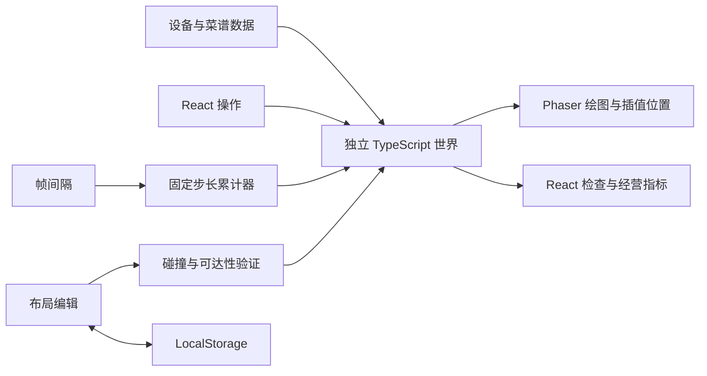

# 架构

## 边界与目录

```text
src/
  app/                 React 入口与界面组合
  data/                设备、工具、食材、菜谱、默认布局
  game/                Phaser 场景、绘图和输入
  simulation/
    types.ts           世界实体与数据契约
    core/
      engine.ts        固定步长、世界、账本、统计和事件
      kitchen.ts       菜谱任务调度、资源锁与米饭批次
      service.ts       顾客生命周期与服务任务
      processing.ts    食材状态选择、合法性验证与消耗
      random.ts        种子随机数及预生成需求
      recipe-validation.ts  菜谱 DAG 与设备/工具校验
    navigation/
      grid.ts          网格、占地、操作位置、A*、布局验证
      movement.ts      移动插值、动态占位与恢复
  ui/                  控制、管理和检查面板
  storage/             LocalStorage 布局存档
  tests/               无渲染模拟与导航测试
scripts/simulate.ts    完整午餐及布局实验命令
```

`simulation/` 和 `data/` 不依赖 React、Phaser、DOM 或 LocalStorage。Node 下可以直接运行完整营业。渲染读取实体位置与状态，不自行创建订单、加工食材或改变收入。

## Simulation Engine

`RestaurantSimulation` 拥有布局、演员、顾客组、订单、厨房任务、服务任务、设备槽、餐桌、库存和事件。所有实体使用稳定唯一 ID 关联，厨房和服务控制器使用同一个世界。

`start()` 开始营业，`advance(realSeconds)` 接收渲染的现实时间并转换成固定 0.25 秒模拟步。`step()` 是无渲染的一个确定性逻辑步，刻意不读取 UI 的暂停和速度。`getMetrics()` 汇总实际执行记录。前端暂停必须通过 `advance()` 的暂停闸门。

每一步依次接纳需求、更新顾客、更新厨房、更新服务、移动演员、累计利用率并检查结束。结束要求全部需求处理完、顾客离开、厨房相关任务完成以及服务清洁结束。超时是诊断事件，不会伪造完成。

## Agent AI 与任务系统

厨师选择已经满足依赖的厨房任务，优先取出被动加工完成的食品，然后按任务创建时间稳定排序。设备选择参考距离，并寻找可达且未占用的实际交互格。

分配任务时绑定厨师、设备容量槽、交互位置和具体食材 ID。原料库存和中间食材分别预约，避免并行工序重复使用物料。食材记录 `locationFixtureId` 与 `heldBy`；厨师先走到输入所在的各个实际工作站，每站领取需要一秒，再带到目标设备加工。完成后消费输入 token，在目标设备位置创建新状态输出，再释放资源。不能直接跨工作站使用远处食品。

被动加工保留设备槽，释放厨师和工位。加工结束后，另一个空闲厨师可以返回取出。米饭批次具有独立任务组：从储物架取六份生米、走到电饭煲、投入、等待加工、取出；订单分别预约一份熟饭。

服务员通过单独任务队列执行迎宾、点单、送餐、结账和清桌。订单记录 `servingFixtureId`，送餐到实际放有该盘餐品的出餐台取餐，然后走向对应餐桌；多个出餐台不能把食品取自另一台。卫生间保留单人容量锁，离座期间席位继续预约，回到座位前暂停用餐倒计时。

## Recipe System

`src/data/catalog.ts` 定义设备支持的加工方法、工具、容量、占地、交互槽和成本；食材定义初始标签与成本；菜谱定义工序 DAG。

工序包含 ID、方法、设备和工具要求、依赖、主动/被动/取出时间、输入标签与输出标签。`processing.ts` 验证输入未消耗且状态正确，处理过程中消费这些具体对象。菜品不是一个总倒计时。现有 Cut、Coat、PanSear、DeepFry、Heat、CookRice、Assemble 等工序展示这一流程；数据类型还支持其他加工方法。

扩展一个符合现有方法的新菜谱可增加数据；引入新的机制或全新资源规则仍需扩展调度器与测试。初始化前通过 `validateRecipe()` 拒绝重复工序 ID、缺失依赖、循环、非法时长/食材数量和设备/工具不兼容。仍需以集成测试验证完整物料状态链。

## Navigation

网格使用四邻接 A*，路径不含起点，包含终点。墙壁、家具与设备占地格不可通行；旋转会改变占地和操作格。布局验证检查碰撞、边界、入口/出口和操作位置连通性。顾客等候格与员工出生格必须从入口可达，防止在墙壁或家具围出的孤立空格中等待。

移动器逐步插值演员位置，并预约移动边的起点与终点，禁止对向换格或穿透。演员具有半径，单格占位方案保守限制同格并行。路径缓存到需要绕障时才更新；等待超过 1.5 秒后限频重规划，空闲员工可以让位。厨房长期受阻会尝试另一个工位。极端拥堵诊断留在事件流中。

## Rendering 与 Data Flow



前端在合理频率读取快照来刷新面板，Phaser 单独绘制地图、设备、演员状态、选中与路线。高倍速仍执行完整逻辑步；每次回调有限预算，剩余模拟时间留在累计器中，避免单次长期阻塞。

存档具有版本号，并验证实体、坐标、旋转、布局合法性。只保存基础布局，不序列化控制器内部资源锁或进行中的营业。
